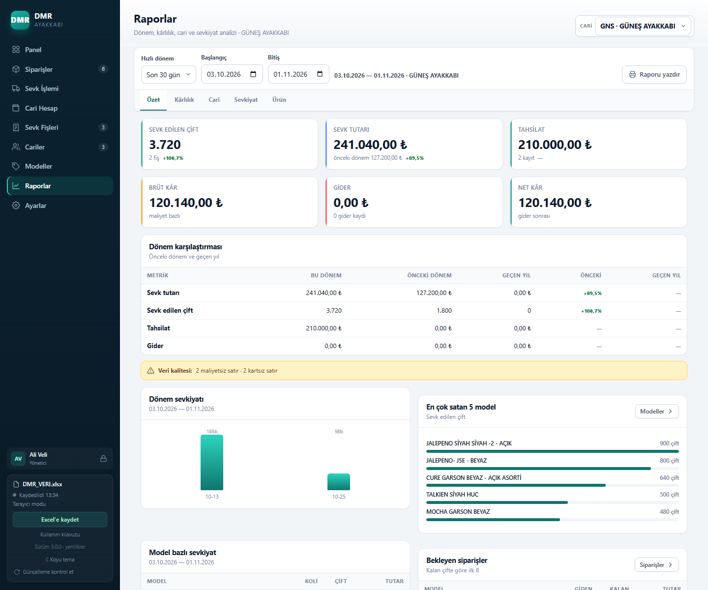
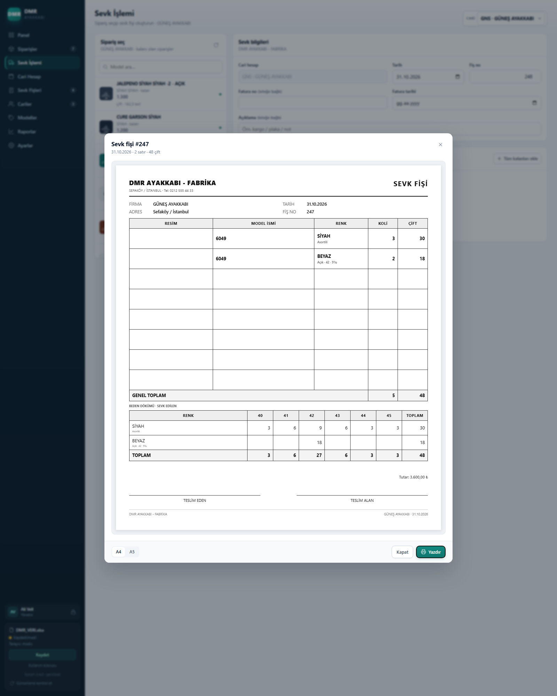

# Değişiklik Günlüğü

Tüm önemli değişiklikler bu dosyada tutulur. Sürümler `vMAJOR.MINOR.PATCH` etiketleriyle işaretlenir.

## v3.1.0 — 01.11.2026

### Rapor Merkezi
- **Sekmeler:** Özet · Kârlılık · Cari · Sevkiyat · Ürün.
- **Tarih aralığı:** Son 30 gün, bu ay, geçen ay, çeyrek, yıl başı, özel aralık.
- **Karşılaştırma:** önceki dönem ve geçen yıl; ciro, çift, tahsilat, gider.
- **Kârlılık:** model ve renk bazlı ciro/maliyet/kâr/marj; maliyetsiz ve kartsız satır uyarısı.
- **Cari:** 0–30/31–60/61–90/90+ yaşlandırma, FIFO tahsilat, ortalama tahsil süresi.
- **Sevkiyat:** ortalama sevk süresi, karşılama oranı, kısmi sevk, geciken siparişler.
- **Ürün:** beden dökümü, renk dağılımı, asorti sapması, hareketsiz modeller.
- **Gider/net kâr** ve GİDER dökümü.
- **Veri kalitesi:** maliyetsiz model/satır, kartsız satır, fiyatsız sipariş, cari/sevk farkı.
- Satırlardan sipariş/cari detayına geçiş; gelişmiş rapor yazdırma.

## v3.0.0 — 01.11.2026

### Görsel / UX
- **Dashboard:** aylık sevkiyatın yanında **en çok satan 5 model**, **sevk durumu donut** ve **cari dağılımı** grafikleri.
- **Model galerisi:** 150 px görselli kartlar, renk çipleri, liste/koli/kalan ve **Kart / Tablo** geçişi.
- **Sevk seçim kartları:** ürün görseli, kalan çift ve koli rozetleri.
- **Fiş:** QR doğrulama, **Müşteri kopyası** etiketi ve **Teslim Edildi** damgası.
- **Ctrl+K hızlı komut paleti:** yeni sipariş, sevk, cari, model, rapor, güncelleme ve tema.
- **Koyu tema** ve mobil **alt filtre paneli**.
- Kartlarda resme tıklayınca **lightbox**.

### Teknik
- QR üretimi için MIT lisanslı `qrcode-generator` gömüldü; harici servis/CDN yok.
- Veri şeması değişmedi; Excel dosyanız aynı kalır.

## v2.7.0 — 01.11.2026

### Eklendi
- **Model kartı görseli** sipariş ekranında, sevk listesinde ve sevk fişinde otomatik kullanılıyor; tekrar resim eklemek gerekmiyor.
- Sipariş ekranında **ürün kartı görünümü**; **Kart / Tablo** geçişi.
- Kartlarda **92 px**, tabloda **52 px** ürün görseli.
- Model formu görseli **92 px**, sevk fişi görseli **64 px**.
- Siparişe özel görsel yalnızca gerektiğinde ekleniyor; kaldırılınca model görseli görünüyor.

## v2.6.1 — 31.10.2026

### Düzeltildi
- **Cari hesaplar → Düzenle / Sil** butonları çalışmıyordu; eksik fonksiyonlar geri eklendi.
- **Kullanıcı düzenleme, şifre sıfırlama ve kullanıcı silme** geri geldi.
- **closeModals** geri eklendi (yedek geri yükleme ve çöp kutusu sonrası pencereler).
- Eksik fonksiyonlar: `openCariForm`, `removeCari`, `openUserForm`, `openPasswordForm`, `removeKullanici`, `closeModals`.

### Denetim
- 59 `data-act` aksiyonunun tamamı handler’lı.
- 9 `data-role` alanının tamamı handler’lı.
- 18 ekran/modalda runtime hatası: **0**.
- v1.8’e göre eksik üst düzey fonksiyon: **0**.

## v2.6.0 — 31.10.2026

### Eklendi
- Sevk fişi önizlemesinde **Tam ekran / Normal** düğmesi.
- Tam ekranda modal uygulama penceresini kaplar; fiş A4/A5 oranını korur.
- A4/A5 geçişi ve yazdırma tam ekranda da çalışır.

## v2.5.0 — 31.10.2026

### Değişti
- Sevk fişi **5 kolon**: RESİM · MODEL İSMİ · RENK · KOLİ · ÇİFT.
- Model adı ve renk ayrı kolonlarda; ikisi de kalın.
- Tablo yazısı 13 px’e, başlıklar 11 px’e çıkarıldı; fiş başlığı ve firma adı büyütüldü.
- A4 ve A5 fiş tek sayfa kalacak şekilde satır sayısı dengelendi.

## v2.4.0 — 31.10.2026

### Eklendi
- Sol menüde **“Güncelleme kontrol et”** düğmesi.
- **GitHub Releases** üzerinden son sürüm kontrolü (public depo, token yok).
- Yeni sürüm rozeti, sürüm notları ve **DMR_SEVK.html indir** bağlantısı.
- Günde bir otomatik sessiz kontrol; çevrimdışıyken uygulama etkilenmez.
- Otomatik indirme/çalıştırma yok; kullanıcı dosyayı kendisi indirir.

## v2.3.1 — 31.10.2026

### Düzeltildi
- **Model kartına resim ekleme** çalışmıyordu; eksik `imageToDataUrl` fonksiyonu geri eklendi.
- Resim seçilince küçük önizleme oluşur; kaydedince model listesinde görünür.
- Sipariş resmi ve logo yükleme aynı düzeltmeden yararlanır.

## v2.3.0 — 31.10.2026

### Eklendi
- **Cari Hesap → Tahsilat:** cariye alacak olarak hızlı tahsilat girişi.
- **Cari Hesap → Gider:** GİDER işlem türü; varsayılan **cariye borç**, yön alacak olarak değiştirilebilir.
- Gider filtresi ve işlem etiketi.

### Düzeltildi
- Cari hesap **“Hareket ekle”** butonu çalışmıyordu; eksik `openLedgerForm` fonksiyonu geri eklendi.

## v2.2.0 — 31.10.2026

### Eklendi
- **Model kartında “Yeni renk” kısayolu:** Ayarlar’a gitmeden renk tanımlama.
- Yeni renk kaydedilince model formu kapanmaz; renk otomatik seçilir ve renk × beden matrisine eklenir.
- İç içe pencerelerde Escape yalnızca üstteki pencereyi kapatır.

## v2.1.1 — 31.10.2026

### Düzeltildi
- Sipariş satırındaki **renk** artık serbest metin değil, model kartındaki tanımlı renklerden **seçim**.
- Model değiştirildiğinde renk listesi güncellenir; modelde olmayan renk ilk tanımlı renge çekilir.
- Model seçilince satır otomatik **Asortili/Açık** moda geçer.

## v2.1.0 — 31.10.2026

### Eklendi
- **Renk ustası:** Renkler ayrı tabloda (ad, kısa kod, aktif); model kartında çoklu seçim.
- **Asorti şablonları:** Ayarlar’da ad + kategori + beden dağılımı; modele atanır.
- **Model renkleri:** Model ↔ renk ilişkisi ayrı tabloda.
- Model kartında **renk × beden matrisi** önizlemesi.
- Excel: **RENKLER**, **ASORTİ ŞABLONLARI**, **MODEL RENKLERİ** sayfaları.

### Değişti
- Model formu: kategori yerine şablon seçimi; renkler metin yerine usta kayıttan seçilir.
- Eski model kartlarındaki renkler ve asorti şablonları otomatik olarak ustalara taşınır; aynı dağılım tek şablonda birleşir.

### Düzeltildi
- v2.0.1: Modeller sayfasında Düzenle/Sil/Resim butonları.

## v2.0.1 — 31.10.2026

### Düzeltildi
- **Modeller sayfasında Düzenle / Sil / Resim butonları** çalışmıyordu; eksik `modelById`, `showModelImage` ve `removeModel` fonksiyonları geri eklendi.

## v2.0.0 — 31.10.2026

### Eklendi
- **Renk–beden–asorti matrisi:** model kartında kategori (Bebe…Merdane), çoklu renk listesi ve beden bazlı asorti şablonu
- Siparişte renk/beden satırları; **asortili** veya **açık** (tek numara, elle koli içi), aynı siparişte çok renk
- **Satır bazlı sevk:** her renk/beden satırının kalanı ayrı; kısmi sevk ve fazla sevk engeli
- Fişte **yalnızca sevk edilen bedenler**; boş beden kolonu yok; “Açık · 9’lu” etiketi
- **Beden dökümü raporu**; A4/A5 fiş tek sayfa

### Değişti
- Excel: **SİPARİŞ SATIRLARI** sayfası; model kartı ve sevk satırı yeni kolonları
- Sevk ekranı ve sepet sipariş yerine **renk/beden satırı** bazlı
- Eski siparişler `ESKI` satırına taşınır; bakiye, sevk ve kalanlar korunur

### Not
- Eski Excel dosyası ilk açılışta yeni şemaya yükseltilir; veri silinmez.

## v1.8.0 — 30.10.2026

### Değişti
- Proje adı **DMR AYAKKABI** olarak güncellendi; eski proje adı yalnızca müşteri kayıtlarında kalır
- Uygulama dosyası **DMR_SEVK.html**, varsayılan veri dosyası **DMR_VERI.xlsx**
- Varsayılan marka **DMR / AYAKKABI**, kısa işaret **DMR**; ilk cari **YENİ CARİ**
- Eski dosyalardaki marka ayarları açılışta otomatik DMR'ye taşınır (müşteri kayıtlarına dokunulmaz)
- Depo adı **dmr-sevk**

## v1.7.0 — 30.10.2026

### Eklendi
- **Model kartlarına resim**: dosyadan seçme, yapıştırma (Ctrl+V) veya sürükleme; model listesinde fotoğraf
- **Model kartlarına asorti** (çift/koli); siparişte model seçilince asorti otomatik dolar
- Model resimleri için Excel'de gizli MODEL RESİMLERİ sayfası
- Model listesinde fotoğraf ve asorti kolonları; fotoğrafa tıklayınca büyük önizleme

## v1.6.0 — 30.10.2026

### Eklendi
- **Model kartları**: fiyat, maliyet, barkod, sezon; model bazlı sipariş/sevk/kalan özeti
- **Kârlılık raporu**: aylık ciro, maliyet, kâr ve marj; maliyetsiz satır uyarısı
- **Sevk fişine fatura no ve fatura tarihi**; listede görünüm ve düzenleme, basılı fişte satır
- **Siparişi kopyala**: benzer siparişi tek tıkla açma
- **Toplu sevk**: cariye ait tüm kalanları tek fişe ekleme
- **Ctrl+K hızlı arama**: model, cari, fiş ve fatura no
- **Klavye akışı**: Enter ile sonraki alan, Ctrl+Enter ile kaydet, “Kaydet ve yeni”
- **Çöp kutusu**: silinen fiş, sipariş, hareket ve cariyi 30 gün saklama ve geri yükleme
- **İşlem günlüğü**: kim, ne zaman, hangi kaydı değiştirdi
- **Günlük otomatik yedek**: tarayıcıda son 7 gün, tek tıkla geri yükleme ve indirme
- **Dosya sağlık kontrolü**: açılışta tutarsızlık uyarısı
- **Sürüm numarası ve yenilikler** ekranı
- Excel'e `MODEL KARTLARI`, `İŞLEM GÜNLÜĞÜ`, `ÇÖP KUTUSU` sayfaları

### Değişti
- Sevk Fişleri tablosuna fatura kolonu eklendi
- Ayarlar ekranına yedekler ve kayıt güvenliği kartları eklendi

## v1.5.0 — 29.10.2026

- Marka adı, alt başlık, kısa işaret ve logo ayarları
- Mevcut veritabanına cari aktarma; varsayılan dosya adı (ör. `Database`)
- İki panelli yeni giriş ekranı ve “Beni hatırla” (yalnızca kullanıcı adı)

## v1.4.0 — 29.10.2026

- Kullanıcı hesapları, yönetici/kullanıcı rolleri ve oturum kilidi
- A5 sevk fişi
- Resim yolu kolonu kaldırıldı; resimler gömülü önizleme olarak tutuluyor

## v1.3.0 — 28.10.2026

- Çoklu cari hesap ve global fiş numarası
- Cari bazlı ekstre; mevcut kayıtların ilk cariye atanması

## v1.2.0 — 27.10.2026

- Tek HTML dosya, Excel veritabanı
- Sipariş, sevk, cari hesap, raporlar ve yazdırma
