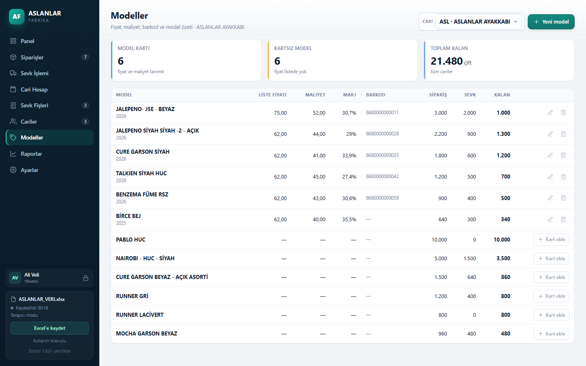

# ASLANLAR FABRİKA — Sevk ve Cari Yönetimi

Tek bir HTML dosyası olarak çalışan, verilerini seçtiğiniz **Excel (.xlsx)** dosyasında tutan sipariş, sevk fişi ve cari hesap uygulaması. Kurulum, sunucu ve internet bağlantısı gerektirmez; Chrome veya Edge ile açılır.

## Özellikler

- Sipariş, model, renk, asorti, fiyat ve kalan çift takibi
- A4 / A5 sevk fişi, fatura no ve tarihi
- Çoklu cari hesap, cari ekstre, tahsilat ve bakiye
- Model kartları: fiyat, maliyet, barkod, sezon; model bazlı kalan
- Kârlılık raporu (ciro, maliyet, kâr, marj)
- Kullanıcı girişi, yönetici/kullanıcı rolleri, oturum kilidi
- İşlem günlüğü, çöp kutusu (30 gün), günlük otomatik yedek (son 7 gün)
- Toplu sevk, sipariş kopyalama, `Ctrl+K` hızlı arama, klavye ile hızlı giriş
- Firma/marka adı ve logo ayarları, Excel'den cari aktarma

## Hızlı başlangıç

1. `ASLANLAR_SEVK.html` dosyasını indirin.
2. Chrome veya Edge ile açın (çift tıklama yeterli).
3. **Yeni dosya oluştur** deyin veya mevcut `.xlsx` veri dosyanızı açın.

Kayıtlar doğrudan seçtiğiniz Excel dosyasına yazılır. Dosyayı OneDrive/Drive klasöründe tutmak ek sürüm geçmişi sağlar.



## Geliştirme

Kaynaklar `src/` altında parçalıdır; `tools/build.py` bunları tek HTML dosyasında birleştirir.

```bash
python tools/build.py
```

| Dosya | İçerik |
|---|---|
| `src/index.html` | HTML iskeleti ve yer tutucular |
| `src/styles.css` | Arayüz stilleri |
| `src/xlsx.js` | Bağımlılıksız XLSX yazma/okuma |
| `src/core.js` | Veri modeli ve iş kuralları |
| `src/ui.js` | Arayüz ve ekranlar |
| `tools/build.py` | Derleme |
| `tools/preview_gen.py` | Demo verili önizleme (geliştirme aracı) |

CI, kaynaklardan yeniden derler ve `ASLANLAR_SEVK.html` dosyasının güncel olduğunu doğrular.

## Excel sayfaları

`CARİLER`, `KULLANICILAR`, `MODEL KARTLARI`, `SİPARİŞLER`, `CARİ HESAP`, `SEVK FİŞLERİ`, `SEVK SATIRLARI`, `İŞLEM GÜNLÜĞÜ`, `ÇÖP KUTUSU`, `RESİMLER` (gizli), `AYARLAR`.

Eski (VBA) dosyalar `Ayarlar → Eski dosyadan yeni veritabanı oluştur` ile veya mevcut veritabanına `Excel dosyasından cari aktar` ile alınabilir.

## Sürüm

Güncel sürüm: **v1.6.0**. Ayrıntılar için `CHANGELOG.md`.

## Gizlilik

Müşteri verileri bu depoda tutulmaz. `.xlsx`, `.xls` ve `.xlsm` dosyaları `.gitignore` ile hariç tutulur; depo yalnızca uygulama kodunu ve demo ekran görüntülerini içerir.

## Lisans

Özel kullanım. Tüm hakları saklıdır.
