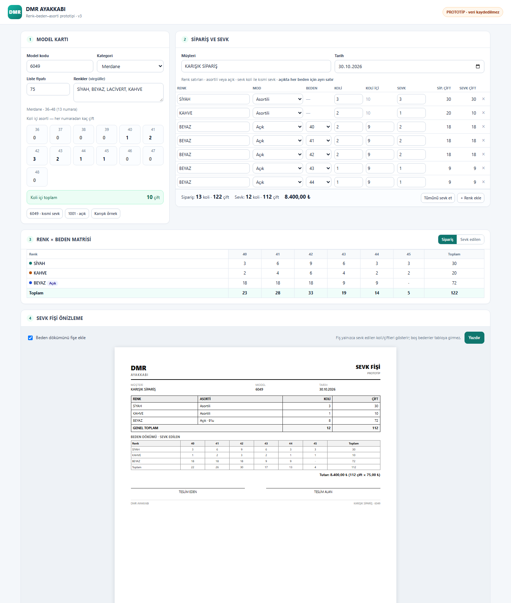

# Yol Haritası

Bu dosya, henüz uygulanmayan ama değerlendirilen geliştirmeleri tutar. Uygulanan işler `CHANGELOG.md` ve GitHub sürümlerine taşınır.

## Renk–beden–asorti matrisi (prototip v3)

**Durum:** Tasarım netleşti, prototip v3 hazır — üretim koduna **henüz alınmadı**. Takip: [#1](https://github.com/msdemir79/dmr-sevk/issues/1)

**Deneme ekranı:** [`prototype/matris.html`](prototype/matris.html) — veri kaydetmez; 6049 kısmi sevk, 1001 açık ve karışık örnekleri içerir.

**Amaç:** Siparişi renk × beden kırılımında girmek; modeldeki asorti şablonuyla koli içi dağılımı hesaplamak; fişte **sevk edilen** miktarların beden dökümünü (isteğe bağlı) göstermek. Sevkiyat ve stok takibi **toplam koli/çift** üzerinden devam eder.

### Netleşen kararlar (30.10.2026)

- **Beden setleri ayrı:** Bebe 22–26, Patik 26–30, Filet 31–35, Garson 36–40, Zenne 36–40, Merdane 36–48. Numaralar EU (Paris); kategori adları Türkiye sektör terimidir.
- **Modelde birden çok renk:** Ör. 6049 → Siyah, Beyaz, Lacivert, Turuncu Beyaz, Beyaz Kırmızı. Siparişte bu renklerden satır açılır; **tek sipariş/tek fişte** toplanır.
- **Asorti model başına tek:** Her modelin tek asortisi olur. Farklı asorti gerektiğinde yeni model kodu açılır (ör. `6049` → `6049-1`).
- **Asorti örneği:** 40–45 için 40-1, 41-2, 42-3, 43-2, 44-1, 45-1 = koli içi 10 çift.
- **Kısmi sevk beden bazında değil:** Sevk ve kalan takibi toplam koli/çift üzerinden yürür.
- **Sevk girişi koli:** Tam koli; ondalıklı koli yok.
- **Açık (tek numara) sipariş:** Koli içi çift **elle** girilir (6, 9, 10, 12…). **Aynı renkte her beden** ayrı satır olarak girilebilir (40, 41, 42…); matris ve fiş renk bazında gruplar.
- **Renk fiyatı:** Aynı modelde renkler arasında fiyat farkı yok; tek liste fiyatı.
- **Fiyat toplam mantığı:** Tutar = sevk edilen çift × liste fiyatı; beden bazlı fiyat yok.
- **Fişte sevk edilen görünür:** Kısmi sevk varsa fiş, siparişin tamamını değil **sevk edilen koli/çifti** gösterir.
- **Fişte boş bedenler gizlenir:** Yalnızca sevk edilen bedenler tabloya girer.
- **Fişte koli içi:** Açık satırlarda “Açık · 9’lu” gibi koli içi bilgisi görünür.

### Prototip v3’ün gösterdikleri

1. Model kartında kategori + beden aralığı + çoklu renk listesi + liste fiyatı + koli içi asorti ızgarası.
2. Siparişte renk satırları; asortili veya açık (açıkta her beden ayrı satır).
3. Asortili satırda sipariş/sevk koli × asorti → numara dağılımı.
4. Açık satırda tek numara, elle koli içi çift; aynı renk altında çok beden.
5. Renk × beden matrisi; sipariş ve sevk görünümü; renk+mod gruplaması.
6. Fiş: yalnızca sevk edilenler; boş beden yok; “Açık · 9’lu”; tutar.

### UX kararı (30.10.2026)

- **Açık çok beden girişi:** Her beden için **ayrı satır** (prototip v3’teki yöntem) seçildi.
- Üretim planı: [docs/matris-uretim-plani.md](docs/matris-uretim-plani.md)

### Aşamalar

1. ✅ Kağıt tasarım — kategori, asorti, açık sipariş, fiş kararları.
2. ✅ HTML prototip v3 — çoklu renk, açıkta çok beden, kısmi sevk, 9’lu, fiyat.
3. ✅ Geri bildirim — açık giriş yöntemi: her beden ayrı satır.
4. ⏳ Çekirdek — veri modeli, Excel şeması (`SİPARİŞ SATIRLARI`), migration, testler.
5. ⏳ Arayüz — mevcut uygulamaya sipariş matrisi + fiş seçeneği.
6. ⏳ Rapor + kabul testi → sürüm.

**Neden önce prototip?** Veri modeli ve fiş yerleşimi değişiyor; mevcut dosyalarla uyumluluk riski var. Gerçek siparişlerle denemeden üretime almamak gerekiyor.

---

### Notlar

- Bu başlık kullanıcı talebiyle 30.10.2026’da yol haritasına alındı.
- Öncelik sırası: önce tasarım + deneme, sonra üretim.
