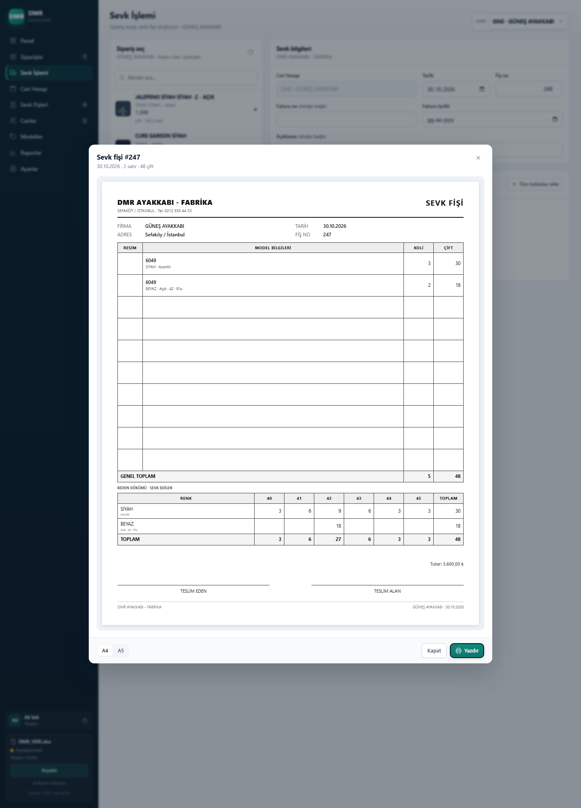
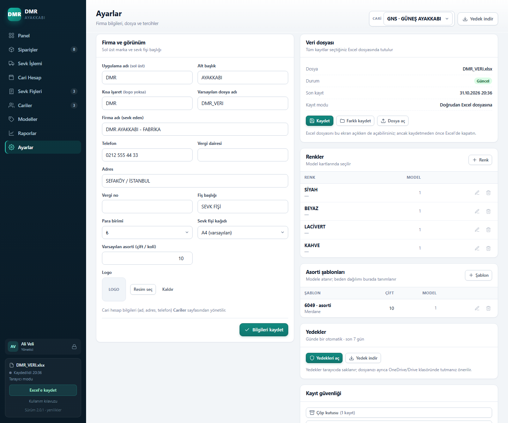
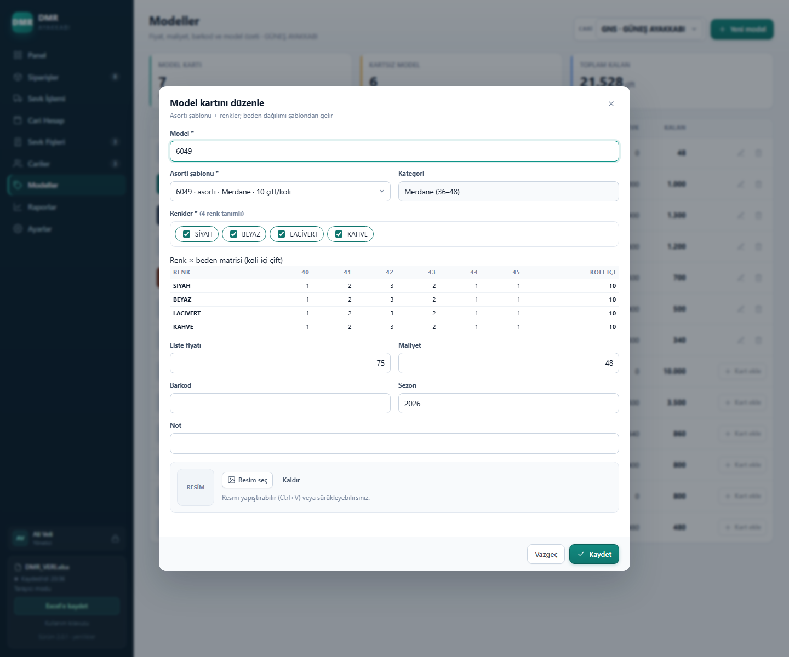

# Renk–beden–asorti matrisi — üretim planı

**Durum:** Renk–beden–asorti matrisi ve renk/şablon ustaları v2.1.0 olarak hazır. `main` güncel.
**Hedef sürüm:** v2.0.0 (veri şeması değişiyor).
**Prototip:** [`prototype/matris.html`](../prototype/matris.html) · **Issue:** [#1](https://github.com/msdemir79/dmr-sevk/issues/1)

**Aşama 3 çıktısı:** satır bazlı sevk, fişte yalnızca sevk edilen bedenler ve “Açık · 9’lu”.

## 1. Veri modeli

### Model kartı (`data.modeller`)
| Alan | Tip | Açıklama |
|---|---|---|
| `id` | sayı | |
| `model` | metin | Model kodu (6049, 6049-1) |
| `kategori` | metin | BEBE/PATIK/FILET/GARSON/ZENNE/MERDANE |
| `renkler` | metin[] | SİYAH, BEYAZ, LACİVERT… |
| `fiyat` | sayı | Tüm renkler için tek fiyat |
| `asorti` | nesne | `{ "40": 1, "41": 2, ... }` koli içi çift |
| `maliyet`, `barkod`, `sezon`, `not` | | Mevcut alanlar |

### Sipariş (`data.orders` + `data.orderLines`)
`orders` başlık olur: `{id, cariId, sipno, tarih, not}`.
`orderLines`: `{id, orderId, renk, mod, beden, koli, koliIci}`

- `mod`: `ASORTILI` | `ACIK` | `ESKI`
- `ASORTILI`: `beden=0`, `koliIci` model asorti toplamı; çift = koli × toplam.
- `ACIK`: `beden` dolu, `koliIci` elle (6/9/10/12); çift = koli × koliIci.
- `ESKI`: eski kayıtlardan gelen tek satır; `beden=0`, `koliIci=asorti`, çift = adet.
- Her renk/beden ayrı satır (kullanıcı kararı).

### Sevk (`data.shipments` + `data.lines`)
`lines`: `{id, sevkId, orderLineId, renk, beden, mod, koli, koliIci, cift, fiyat, tutar, dagilim}`
- `dagilim`: sevk anındaki beden dağılımı (`{ "40": 3, ... }`), model kartı sonradan değişse de fiş bozulmaz.
- Kısmi sevk: koli, sipariş satırının kalanından küçük/eşit; tam koli.
- Cari hesap kaydı sevk satırı başına (mevcut mantık).

### Hesaplar
- Asortili dağılım: `koli × asorti[beden]`.
- Açık dağılım: `koli × koliIci` → tek beden.
- Sipariş/kalan: satır bazında koli ve çift.
- Fiş: yalnızca sevk edilen satırlar; boş bedenler gizli; “Açık · 9’lu”.

## 2. Excel şeması

| Sayfa | Değişiklik |
|---|---|
| `MODEL KARTLARI` | + KATEGORİ, RENKLER (`SİYAH\|BEYAZ`), ASORTİ (`40:1;41:2;…`), FİYAT zaten var |
| `SİPARİŞLER` | Yalnız başlık: ID, CARİ ID, SİP. NO, TARİH, NOT |
| `SİPARİŞ SATIRLARI` | Yeni: ID, SİPARİŞ ID, RENK, MOD, BEDEN, KOLİ, KOLİ İÇİ, ÇİFT |
| `SEVK FİŞLERİ` | Mevcut |
| `SEVK SATIRLARI` | + SİPARİŞ SATIR ID, RENK, BEDEN, MOD, KOLİ İÇİ, DAĞILIM |
| `CARİ HESAP` | + SİPARİŞ SATIR ID |

Eski dosya okunurken `SİPARİŞ SATIRLARI` yoksa her sipariş için `ESKI` satır üretilir; mevcut bakiye/stok korunur.

## 3. Arayüz

1. **Modeller:** kategori, renk listesi, asorti ızgarası, fiyat.
2. **Sipariş:** renk satırları; asortili/açık; açıkta beden + koli içi; satır toplamları.
3. **Sevk:** satır seçimi, koli girişi (kalan kontrolü); fişte sevk edilen beden dökümü.
4. **Fiş:** isteğe bağlı beden tablosu; “Açık · 9’lu”; boş beden yok.
5. **Raporlar:** renk/beden kırılımı eklenir.

## 4. Göç (migration)

- Eski `SİPARİŞLER` satırı → sipariş + `ESKI` satır.
- Eski `SEVK SATIRLARI` → ilgili siparişin `ESKI` satırına bağlanır.
- `ESKI` satırlarda beden dökümü yok; fişte beden tablosu gösterilmez.
- Dosya ilk kayıtta yeni sayfaları ekler; eski veriler silinmez.

## 5. Testler

- 6049 asorti: 5 koli → 5/10/15/10/5/5 = 50; sevk 3+3 → 60.
- 1001 açık: 10 koli × 10 = 100 (40 numara).
- Açık çok beden: 40–44, 9’lu, kısmi sevk.
- Excel gidiş-dönüş: model, renk, asorti, sipariş satırları, sevk dağılımı.
- Eski dosya migration: bakiye ve kalan çiftler değişmiyor.
- Fiş: A4 tek sayfa, boş beden yok, tutar = sevk çift × fiyat.

## 6. Aşamalar

1. **Çekirdek + Excel** — veri modeli, okuma/yazma, migration, birim testleri.
2. **Model + sipariş arayüzü** — kart alanları, renk satırları.
3. **Sevk + fiş** — satır seçimi, koli, beden dökümü.
4. **Rapor + kabul** — renk/beden raporları, gerçek dosya kopyasıyla test.
5. **v2.0.0** — release.

Her aşama `feature/matris` dalında; `main`/v1.8.0 bozulmadan kalır. Gerçek veri dosyasının bir kopyasıyla test edilmeden birleştirilmez.

## 7. Riskler

- Eski dosya migration’ında bakiye/stok kayması → altın dosya testi.
- Sevk satırı–sipariş satırı bağlantısı → foreign key kontrolü ve sağlık testi.
- Fiş A4 yerleşimi (çok renk/beden) → yazdırma testi.
- Model kartı sonradan değişirse eski fişler → `dagilim` snapshot’ı.

## 8. Renk ve asorti şablonu ustaları (v2.1.0)

- **RENKLER:** ad, kısa kod, aktif; model kartında çoklu seçim.
- **ASORTİ ŞABLONLARI:** Ayarlar’da ad + kategori + beden dağılımı; modele atanır.
- **MODEL RENKLERİ:** model ↔ renk ilişkisi.
- Model kartında **renk × beden matrisi** önizlemesi.
- Excel 16 sayfa; eski kartlar otomatik ustalara taşınır.

